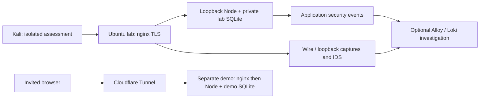

# Security lab structure and decisions

**Date:** 2 November 2026. **Status:** proposed implementation structure reflecting the requested learning/demo direction; detailed configurations and installed evidence remain open. [Plan](security-lab-plan.md).

## Requirements

Learn nginx incrementally, retain the existing Node/game architecture, isolate active assessments, support an optional invited domain demo, and preserve a repeatable attack/detect/fix story. Bound resource use and evidence retention. Avoid credentials in version control. Keep lab modules independent of engine runtime imports.

## Topology

This diagram is a target design, not a claim of deployment. Containers/VM adapters, capture interfaces and private scrape connectivity need implementation proof.

## ADR LAB-01 — separate isolated assessment and invited demo

**Decision:** distinct instances/databases/credentials; active scans target only the isolated inventory. Demo uses a separate connector and Access policy before invited use.
**Alternative:** one VM switched between tunnel and assessment roles.
**Trade-off:** duplicate configuration/storage work buys a stable boundary and avoids accidentally publishing the vulnerable target.
**Failure handling:** campaign refuses demo/unknown profiles; tunnel failure affects demo availability only; restore lab snapshots without touching demo data.

## ADR LAB-02 — learn nginx before adding the tunnel

**Decision:** Node → nginx HTTP → local TLS in the isolated profile. Demo later uses cloudflared → nginx → Node. Direct cloudflared → Node may be documented as a variant.
**Alternative:** bypass nginx from the start.
**Trade-off:** one more process/config to learn, but direct experience with static files, proxy routes, WebSockets, headers, TLS and logs. No new frontend framework or game engine.
**Failure handling:** isolate Node, proxy and TLS checkpoints so errors have a known boundary; protect private API/metrics/inspection paths.

## ADR LAB-03 — baseline evidence before a full monitoring stack

**Decision:** first bounded campaign after the isolated host works; raw logs/PCAP are valid evidence. Add metrics and proven IDS rules, then searchable logs using Alloy/Loki.
**Alternative:** implement every dashboard before assessment.
**Trade-off:** earlier complete learning loop; initial investigation is manual. Correlation requires shared context and parser proof, not merely installing Loki.
**Failure handling:** missing telemetry produces an explicit inconclusive detection result, never a finding inferred from a missing counter.

## Open design ledger

| Item | Where to resolve | Proof needed |
|---|---|---|
| Explicit Node listen host | application/config change, Phase 2 | listener limited to intended interface |
| JSON security sink / trusted client attribution | telemetry implementation | auth/rejection events with safe context and canary controls |
| Metrics isolation across container namespace | monitoring design | collector can scrape; public visitor cannot |
| Suricata version/parser/capture settings | sensor design | real transport PCAPs and decoding limits |
| Sizes / budgets / retention | per-host provisioning | measured RAM/disk and bounded campaign |
| TLS trust / certificate source | local nginx runbook | verification succeeds without disabling trust |
| Cloudflare Access / headers / reconnect | optional demo | invited journey and client-IP attribution proof |
| Crypto envelope / reader integration | optional later ADR | key/nonce/tamper/rotation and tool compatibility |

## Primary references

- [nginx beginner guide](https://nginx.org/en/docs/beginners_guide.html) and [WebSocket proxying](https://nginx.org/en/docs/http/websocket.html).
- [Cloudflare Tunnel](https://developers.cloudflare.com/tunnel/) and [WebSocket limits](https://developers.cloudflare.com/network/websockets/): edge WAF does not inspect established WebSocket messages.
- [Suricata WebSocket buffers](https://docs.suricata.io/en/suricata-8.0.2/rules/websocket-keywords.html): verify the selected version and payload limits.
- [Alloy migration](https://grafana.com/docs/grafana-cloud/send-data/alloy/set-up/migrate/from-promtail/): Promtail reached EOL on 2 March 2026.
- [Loki labels](https://grafana.com/docs/loki/latest/get-started/labels/): high-cardinality request/account context belongs in fields.
- [Authenticated encryption](https://cryptography.io/en/latest/hazmat/primitives/aead/): GCM authentication does not solve all log lifecycle threats.
